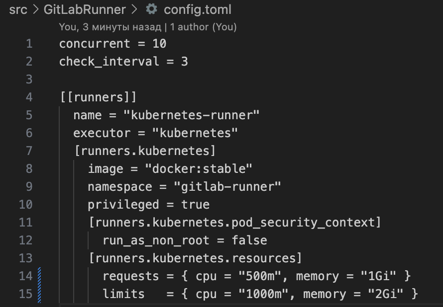

# Непрерывные интеграция и доставка 

## Contents

1. [Chapter I](#chapter-i) 
2. [Chapter II](#chapter-ii) \
   2.1. [Настройка CI и CD](#part-1-настройка-ci-и-cd)

## Chapter I

**CI/CD** — это набор практик, которые позволяют разработчикам налаживать и облегчать процесс развертывания разрабатываемого приложения. Непривычная интеграция позволяет представить процесс разработки приложения как последовательность мелких итераций, каждый из которых старается сохранить непрерывность в вопросе интеграции изменений. То есть код изменяется в системе контроля версий, автоматически собирается и тестируется при каждой значащей модификации. Непрерывная доставка отвечает за развертывание собранного приложения в целевом окружении. Таким образом, принципы CI/CD позволяют изменениям безопасно и непрерывно попадать на продакшн.

## Chapter II

Итогом выполненной работы должен быть отчет с подробными описаниями выполнения каждого из пунктов, подкрепленного скриншотами. Отчет формируется в виде markdown-файла в директории `src` с именем `REPORT.MD`.

## Part 1. Настройка CI и CD

### Задание

1. Склонировать рабочий репозиторий.

2. Получить доступ к удаленному кластеру Kubernetes.


3. Создать отдельный неймспейс для раннера GitLab.


#### Почему создаётся отдельный namespace для GitLab Runner
- Изоляция ресурсов
`Namespace` в `Kubernetes` позволяет логически отделить все компоненты `GitLab Runner` (поды, сервисные аккаунты, секреты, конфигурационные карты) от других приложений и сервисов, работающих в кластере. Это предотвращает случайные или намеренные пересечения и конфликты имён.

- Безопасность (least privilege)
Ограничивается область действия RBAC-правил. Раннеру требуются права на создание подов, чтение логов и т.д. Эти права можно выдать только внутри его собственного namespace, не предоставляя доступа к другим пространствам кластера. Таким образом, даже при компрометации раннера злоумышленник не сможет воздействовать на критическую инфраструктуру в других namespace.

- Управление квотами и лимитами
Можно настроить ResourceQuota и LimitRange именно для этого namespace, контролируя суммарное потребление ресурсов (CPU, память) всеми подами раннера и подами, которые он создаёт для CI-задач. Это защищает кластер от исчерпания ресурсов.

- Чистота и удобство администрирования
Логи, метрики, события и политики сетевой безопасности можно применять целенаправленно к одному namespace. Упрощается мониторинг, отладка и ротация секретов. При необходимости удалить всё, что связано с CI/CD, достаточно удалить namespace — все дочерние ресурсы будут удалены автоматически.

- Соответствие лучшим практикам
Официальная документация GitLab и Kubernetes рекомендует разворачивать раннера в отдельном namespace. Это стандартный подход для production-сред и для изолированных окружений разработки.

Таким образом, создание отдельного namespace — критически важный шаг для обеспечения безопасности, стабильности и управляемости CI/CD инфраструктуры.

4. Установить раннер GitLab в кластере Kubernetes: ты можешь использовать Helm-чарт для раннера GitLab, чтобы установить его в своем кластере Kubernetes. Helm-чарт автоматически создаст развертывание для раннера, который создаст один или несколько модулей, выполняющие задания контейнеров приложения.

- Перед установкой GitLab Runner с помощью Helm-чарта необходимо добавить официальный репозиторий GitLab и обновить информацию о доступных чартах. Это стандартная процедура, обеспечивающая доступ к актуальной версии чарта `gitlab-runner`. 
```
helm repo add gitlab https://charts.gitlab.io
helm repo update
helm search repo gitlab
```


- Развернем `GitLab Runner` в созданном ранее namespace `gitlab-runner`, используя официальный `Helm-чарт`. На этом этапе не выполняем автоматическау регистрацию раннера(хотя можно) — мы подготовим инфраструктуру, а регистрацию проведём вручную на следующем шаге с помощью собственного файла `config.toml`
Подготавливаем `values.yaml` 

Создаётся минимальный конфигурационный файл, который:

- Указывает адрес вашего GitLab-сервера (gitlabUrl).

- Включает создание RBAC-правил (rbac.create: true) — это даст раннеру минимально необходимые права внутри своего namespace.

- Отключает автоматическую регистрацию, чтобы мы могли вручную зарегистрировать раннер с нашим config.toml (параметры registerToken и runnerToken оставлены пустыми).
```
helm install gitlab-runner \ 
  --namespace gitlab-runner \
  -f values.yaml \
  gitlab/gitlab-runner
```

- После выполнения команды Helm выводит сообщение об успешном развёртывании. В namespace gitlab-runner создаётся Deployment и под (одинэкземпляр раннера). Однако раннер не зарегистрирован, так как мы отключили автоматическую регистрацию.

5. Создать секрет для хранения регистрационного токена GitLab.

Для хранения регистрационного токена GitLab был создан Kubernetes Secret. Чтобы избежать утечки токена через историю команд или список процессов, использовался безопасный метод, исключающий передачу токена в аргументах командной строки.
- Создание временного файла с токеном
Через текстовый редактор nano token.txt был вручную вставлен регистрационный токен. Команда nano не сохраняет содержимое файла в истории shell, что предотвращает попадание токена в .bash_history или .zsh_history.
-Выполнена команда:
```
kubectl create secret generic gitlab-runner-token \
  --namespace gitlab-runner \
   --from-file=runner-token=token.txt
```
Ключ --from-file позволяет прочитать значение токена непосредственно из файла, не раскрывая его в командной строке.
Результат: secret/gitlab-runner-token created.
- Безопасное удаление временного файла - используем `shred` для перезаписи содержимого файла перед удалением .


6. Создать конфигурационный файл `config.toml` для использования установленного на выданном кластере Kubernetes раннера. Там же необходимо указать ограничения по ресурсам и докер-образ (например, `docker:stable`). Зарегистрировать установленный раннер при помощи написанного конфигурационного файла.

- 
Вместо ручного создания `config.toml` и его копирования в под, я использовал декларативный подход: встроил конфигурацию раннера прямо в `values.yaml` для `Helm-чарта`. Это позволило:

- управлять всей конфигурацией через один файл,

- автоматически применять её при установке/обновлении раннера,

- избежать ручных операций внутри пода.


Параметры:

- `concurrent = 10` — максимальное количество одновременно выполняемых заданий.

- `check_interval = 3` — интервал проверки новых заданий (сек).

- `executor = "kubernetes"` — задания будут выполняться в виде подов в кластере.

- `image = "docker:stable"` — образ для выполнения скриптов (включает Docker CLI).

- `privileged = true` — необходим для запуска Docker-in-Docker (dind) внутри заданий.

- `Заданы лимиты CPU и памяти, чтобы избежать исчерпания ресурсов кластера.


Параметр `runners.config` содержит в точности тот `config.toml`, который будет использован раннером.

Секция `secrets` ссылается на ранее созданный `Kubernetes Secret` с регистрационным токеном (gitlab-runner-token).

При установке `Helm-чарта` раннер автоматически зарегистрируется в GitLab, используя этот токен..


7. Разработать следующий пайплайн:

   - build — сборка приложения (запускать автоматически для веток с префиксом `feature_`);
   - test — запуск модульных тестов и функциональных тестов postman через утилиту newman (запускать автоматически для веток с префиксом `feature_`);
   - staging — запуск приложения в staging-окружении (запускать мануально и только для тегов).

Пайплайн описан в файле `.gitlab-ci.yml` и состоит из четырёх стадий: `build, test, docker-build, staging`.
Настройки запуска соответствуют требованиям:

`build` и `test` автоматически запускаются для веток с префиксом `feature_*`, а также для тегов.

`docker-build` запускается только для тегов, сборка образов релизных версий.

`staging` запускается вручную (when: manual) и только для тегов, что позволяет контролировать момент развёртывания.

- В начале файла `.gitlab-ci.yml` определены переменные `(variables)` и настройки кэша `(cache)`. Это позволяет централизованно управлять параметрами, которые используются во всех стадиях пайплайна.


  Назначение основных групп переменных:

`Maven:`
`MAVEN_OPTS` определяет локальный репозиторий зависимостей (внутри папки .m2/repository). Кэширование папки `.m2/repository/` позволяет сохранять загруженные `Maven-зависимости` между выполнениями пайплайна. Это значительно сокращает время сборки, так как повторная загрузка библиотек не требуется. Кэш действует для всех стадий, использующих `Maven` (build и test).

`Docker Hub`:
`DOCKER_HUB_USER и DOCKER_HUB_PASSWORD` используются на стадии `docker-build` для аутентификации в `Docker Hub` и публикации собранных образов. Пароль представлен в виде персонального токена доступа (access token), что безопаснее, чем использование пароля учётной записи.

Примечание: чувствительные данные (токен Docker Hub, приватный ключ) в реальном проекте должны передаваться через защищённые переменные GitLab (Settings → CI/CD → Variables)
    
    
   ### Тестовые зависимости:

- `POSTGRES_*` – параметры подключения к `PostgreSQL`, который поднимается как служебный контейнер на стадии тестирования (test).

`RABBIT_MQ_*` – аналогично для `RabbitMQ`.

`*_SERVICE_HOST: localhost` – временные значения, используемые в модульных тестах (сами тесты запускаются в изоляции, сервисы не поднимаются). В реальном окружении (staging) эти адреса будут переопределены с помощью переменных окружения, переданных в контейнеры.

`UUID сервисов:`
`GATEWAY_SERVICE_UUID и BOOKING_SERVICE_UUID` – идентификаторы сервисов, необходимые для межсервисного взаимодействия. В тестовой среде они заданы нулевыми значениями.

`Секреты (авторизация):`
`PRIVATE_KEY и PUBLIC_KEY` – приватный и публичный ключи для JWT. Хранятся в виде base64-строк. На стадии build эти ключи инжектятся в каждый файл application.properties, что обеспечивает единообразную авторизацию во всех микросервисах.

   ### Стадия build – сборка микросервисов


Стадия `build` отвечает за компиляцию всех микросервисов ( booking, hotel, loyalty, payment, gateway, report, session). Она использует официальный образ maven:3.8-openjdk-17, в котором уже установлены Java 17 и Maven.

-  Подготовка файлов конфигурации (before_script)
Перед компиляцией выполняется поиск всех файлов application.properties в директории src/services . В каждый найденный файл дописываются две строки:
```
security.private-key=${PRIVATE_KEY}
security.public-key=${PUBLIC_KEY}
```
Это необходимо, чтобы все сервисы получили ключи для подписи и валидации J`WT-токенов`. Переменные `PRIVATE_KEY и PUBLIC_KEY` определены в `variables` и содержат ключи в формате Base64. Такой подход позволяет хранить чувствительные данные в CI-переменных, не зашивая их в код.

 - Компиляция (script)
Последовательно выполняются команды яmvn clean compileя для каждого сервиса. 
Каждая команда:
- Переходит в папку соответствующего сервиса.

- Удаляет старые скомпилированные классы (clean).

- Компилирует исходный код (compile).

-  Артефакты (artifacts) Все скомпилированные классы (папка target/ каждого сервиса) сохраняются как артефакты пайплайна. Это необходимо для последующей стадии test, где запускаются модульные тесты. Артефакты содержат файлы .class, а также тестовые отчёты. Они доступны для скачивания в течение 1 часа (expire_in: 1 hour), что достаточно для завершения пайплайна.

- `Условия запуска (only)`
Стадия выполняется только для:

Веток, имя которых начинается с `feature_`. Это позволяет автоматически проверять каждый новый функционал.

Тегов (например, v1.0.0). Это гарантирует, что релизные версии также будут собраны.

-  Дополнительные настройки
Флаг `interruptible: true` означает, что если в ту же ветку или тег будет запущен новый пайплайн, текущий может быть прерван. Это экономит ресурсы CI при частых пушах в feature-ветку.

Результат работы стадии
После успешного выполнения build все сервисы скомпилированы, сгенерированные .class-файлы сохранены в артефактах. В файлы application.properties добавлены ключи авторизации, что позволяет сервисам работать с JWT.

Этот этап является основой для дальнейшего тестирования и контейнеризации.

   ### Стадия test – модульные тесты (Unit Tests)
   .png)

   - Параллельное выполнение: parallel: matrix: заставляет GitLab CI создать отдельный под для каждого сервиса. Все тесты выполняются одновременно, что сокращает общее время с 7 последовательных запусков до времени самого долгого из них (обычно 1–2 минуты).

- Ожидание сервисов (before_script): Проверка портов через echo > /dev/tcp/... – это простой и надёжный способ дождаться, пока база данных и брокер очередей поднимутся. Без этого тесты могут начаться раньше, чем сервисы станут доступны, и упадут.

- Артефакты: Отчёты surefire-reports/ сохраняются в формате JUnit. Их можно просмотреть в GitLab (раздел "Тесты" в джобе) или скачать для детального анализа.

- Срок хранения: Артефакты модульных тестов хранятся неделю, что достаточно для анализа любых проблем после выполнения пайплайна.

- Стадия `test` запускает модульные (unit) тесты для всех микросервисов. Эти тесты проверяют отдельные классы и методы в изоляции от внешних зависимостей (базы данных, очередей, других сервисов). Для тестов, которые всё же требуют подключения к БД или RabbitMQ, в CI поднимаются временные контейнеры (PostgreSQL 13 и RabbitMQ 3.13). Все семь сервисов тестируются параллельно, что ускоряет общее время выполнения.

- Модульные тесты (эта стадия) не требуют развёрнутого приложения. Они запускаются в изолированной среде CI и выполняются быстро. Ошибка в одном сервисе не мешает тестированию других.
- Функциональные тесты (Postman + Newman) вынесены в стадию staging и выполняются после успешного развёртывания приложения. Кроме того, стадия staging запускается вручную и только для Git-тегов – то есть для релизных версий. Таким образом, полноценное тестирование всей системы происходит перед релизом, а не на каждый коммит.

### Стадия docker-build – сборка Docker-образов с помощью Kaniko


Стадия docker-build отвечает за создание Docker-образов всех микросервисов и их публикацию в Docker Hub. Для этого используется Kaniko – инструмент от Google, который собирает образы без доступа к Docker daemon. 

Почему `Kaniko`, а не классический `docker build`?

Традиционный подход требует docker:dind (Docker-in-Docker) и привилегированного режима для пода. В нашем кластере мы столкнулись с проблемами подключения к сокету, даже после монтирования /var/run/docker.sock. Кроме того, DinD часто работает нестабильно в Kubernetes.

Kaniko не требует демона Docker. Он выполняет сборку внутри контейнера, используя собственный движок. Достаточно смонтировать контекст сборки (исходный код) и указать Dockerfile. Kaniko поддерживает кэширование слоёв, что ускоряет повторные сборки.

В результате мы получили надёжную и быструю стадию сборки, которая работает без привилегий и не зависит от состояния Docker daemon на нодах кластера.

После выполнения стадии в Docker Hub появляются образы с тегами, соответствующими Git-тегу. Например, для тега v3.5.2 будут созданы:

swarthma/booking-service:v3.5.2 и swarthma/booking-service:latest


Стадия `staging` объединяет два важных действия:

- Развёртывание приложения в Kubernetes с помощью Helm (в неймспейсе staging).

- Запуск функциональных (интеграционных) тестов Postman (Newman) против работающего окружения.

Она выполняется вручную (when: manual) и только для Git-тегов, что соответствует требованиям задания. Это гарантирует, что полное тестирование всей системы происходит только для подготовленных релизных версий.

-  Подготовка окружения (before_script)
Устанавливаются инструменты: kubectl, curl, nodejs, npm.

Создаётся неймспейс staging, если его ещё нет. Команда kubectl create ns staging --dry-run=client -o yaml | kubectl apply -f - безопасно создаёт неймспейс (если не существует) без ошибки в случае, если он уже есть.

-  Развёртывание через Helm
`helm upgrade --install `обновляет или устанавливает релиз myapp с параметрами:

`--namespace staging `– в этом пространстве будут созданы все ресурсы.

`--set imageTag=$CI_COMMIT_TAG` – передаёт Git-тег, который будет использован как версия образов.

`--set <service>.image=swarthma/<service> `– указывает имя образа в Docker Hub. Так как репозиторий имеет вид swarthma/booking-service, а тег передаётся отдельно через imageTag, конечный образ будет swarthma/booking-service:$CI_COMMIT_TAG.

`--wait`` – Helm ожидает, пока все поды не перейдут в состояние Running (и readinessProbe пройдут).

- Задержка перед тестами
Команда sleep 30 даёт приложениям дополнительное время для полной инициализации (загрузка Spring-контекста, подключение к базам данных, инициализация очередей). Это повышает надёжность тестов, так как иногда --wait не означает, что приложение уже принимает HTTP-запросы.

-  Запуск функциональных тестов (Newman)
Устанавливаются:

`newman `– командная строка для запуска коллекций Postman.

`newman-reporter-html` – дополнительный репортер для генерации красивых HTML-отчётов.

Затем запускается коллекция application_tests.postman_collection.json с окружением staging-env.json:

`--reporters junit,html` – создаются два отчёта: JUnit (для CI) и HTML (для человека).

`--reporter-*-export` – указываются имена выходных файлов.

- Артефакты
`HTML-отчёт` (`newman-report.html`) сохраняется как артефакт (его можно скачать и открыть в браузере).

`JUnit-отчёт` (`newman-report.xml`) также сохраняется и автоматически распознаётся GitLab как отчёт о тестах (раздел “Tests” в джобе).

-  Окружение
environment: name: staging – связывает джобу с окружением staging в GitLab. В дальнейшем можно смотреть историю деплоев и удобно переключаться между версиями.


8. Внести изменение в код приложения. Добавить новую зависимость в `pom.xml` файл и зафиксировать изменение.

Для демонстрации возможности CI/CD реагировать на изменения кода мы добавили новую зависимость в один из микросервисов – booking-service. Зависимость была выбрана произвольно, например spring-boot-starter-actuator (для метрик и health checks). Это изменение не влияет на логику работы, но требует пересборки и перетестирования.
Добавление зависимости в pom.xml
Открываем файл src/services/booking-service/pom.xml и в секцию <dependencies> добавляем:
```
<dependency>
    <groupId>org.springframework.boot</groupId>
    <artifactId>spring-boot-starter-actuator</artifactId>
</dependency>
```

 
 Фиксация изменения
 
 Этапы выполнения пайплайна:
 
 СБОРКА DOCKER-ОБРАЗОВ:
 
 STAGING деплой + функциональные тесты Newman
 
 
 Результат функциональных тестов postman:
 